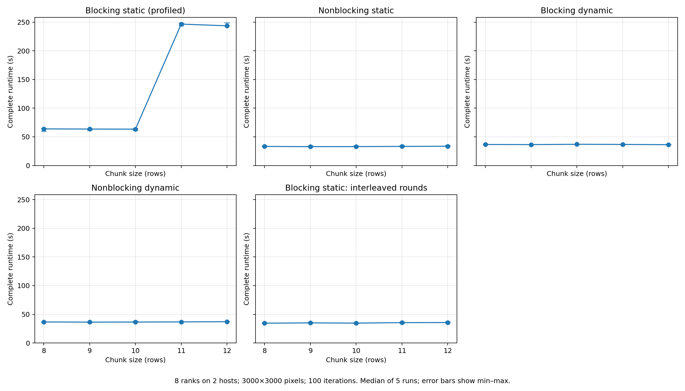
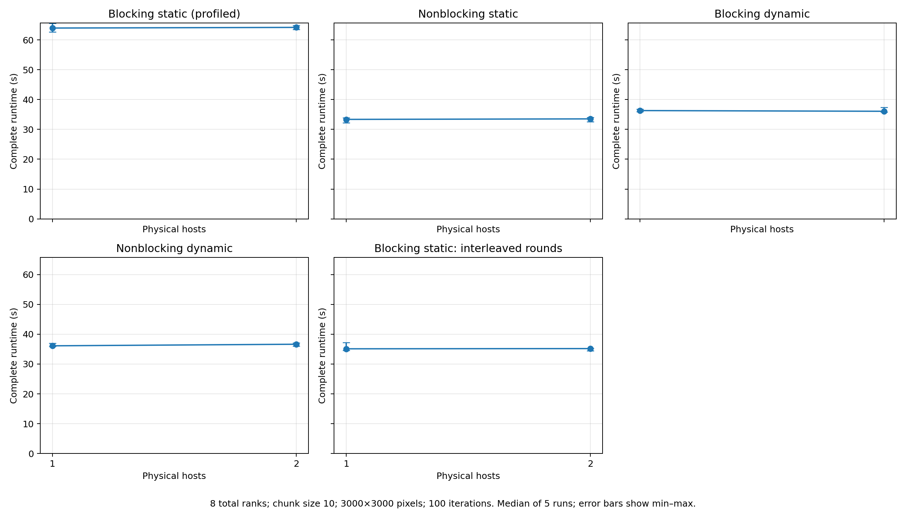
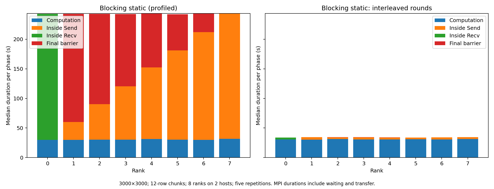
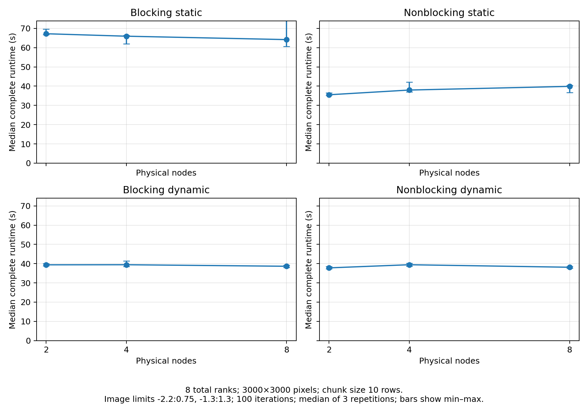
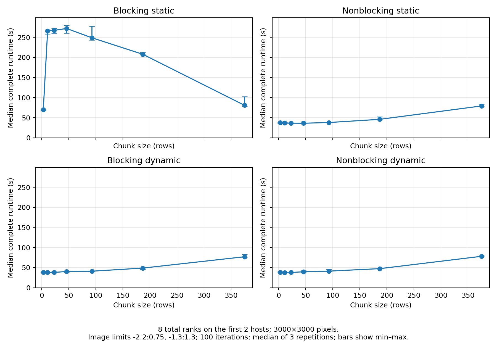
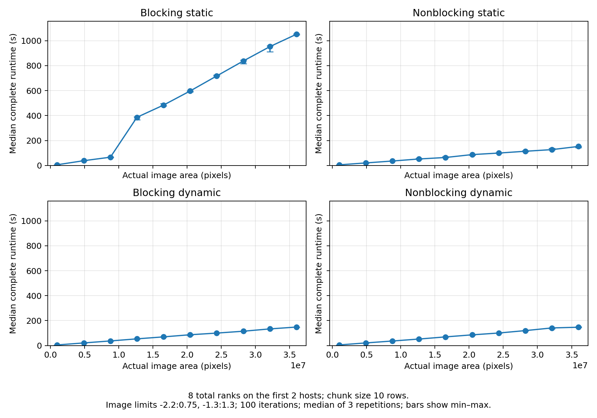
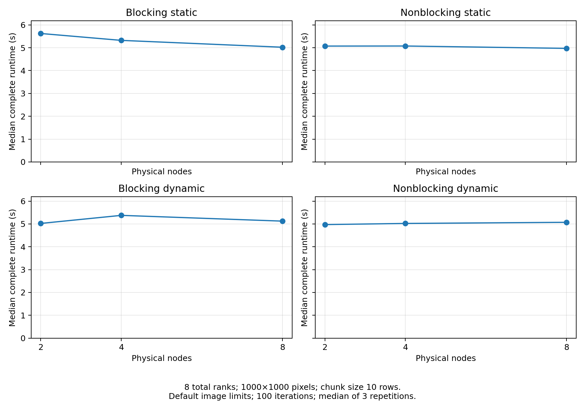
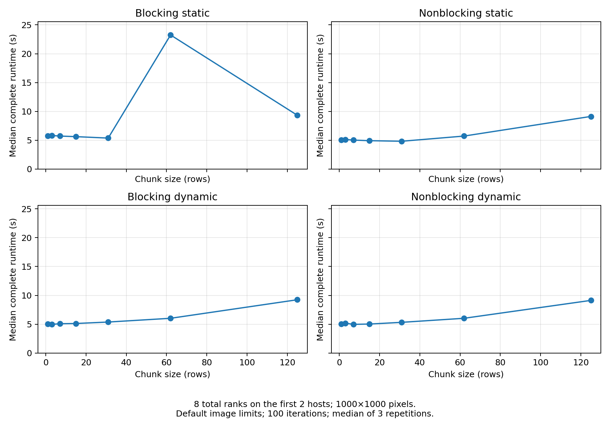
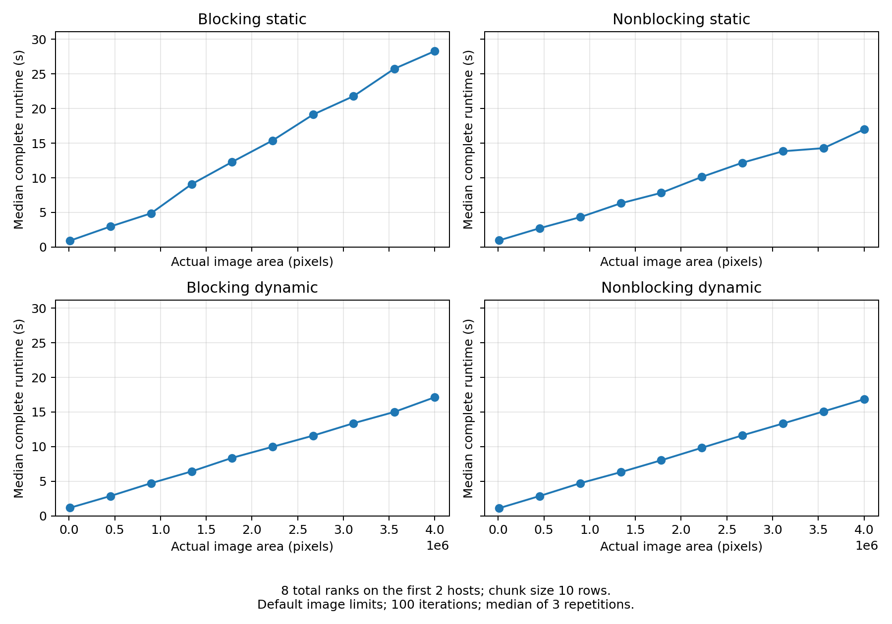

# 02616 Large Scale Modeling — Mandelbrot project

Group workspace for Project 1: compare four MPI implementations of the Mandelbrot
calculation using static/dynamic scheduling and blocking/nonblocking communication.
The initial experiment suite has run successfully: **240 measurements**, with
three repetitions per configuration, and three figures exported as PNG and PDF.

<!-- followup:start -->
## Completed diagnostic follow-up

Job **29702836**: **175 successful measurements**, five repetitions; 3000×3000 pixels, eight ranks; chunks 8–12 and one versus two hosts.

[Results and interpretation](Week05/results/followup_job_29702836/SUMMARY.md). CPU: Intel(R) Xeon(R) Gold 6226R CPU @ 2.90GHz.



[PDF](Week05/results/followup_job_29702836/figures/threshold.pdf)



[PDF](Week05/results/followup_job_29702836/figures/one_vs_two.pdf)



[PDF](Week05/results/followup_job_29702836/figures/rank_timings.pdf)
<!-- followup:end -->

<!-- latest-benchmark:start -->
## Latest completed benchmark

Job **29618553**: 240 successful measurements, three repetitions per configuration, on the same allocated hosts. CPU: Intel(R) Xeon(R) CPU E5-2660 v3 @ 2.60GHz.

Node and chunk tests: 3000×3000 pixels. [Saved results](Week05/results/job_29618553/metadata.json) include configuration, timings, source snapshots, placement checks and logs.

### Nodes



[Download PDF](Week05/results/job_29618553/figures/nodes.pdf)

### Chunk Size



[Download PDF](Week05/results/job_29618553/figures/chunk_size.pdf)

### Image Area



[Download PDF](Week05/results/job_29618553/figures/image_area.pdf)
<!-- latest-benchmark:end -->

## Analysis and diagnostic follow-up

Read the [results analysis](Week05/RESULTS_ANALYSIS.md) for measured comparisons,
code-based explanations and repetition ranges. The heavy-suite plots above now
include min–max error bars; earlier figure exports are preserved in the results archive.

The [focused follow-up](Week05/FOLLOWUP.md) tests chunks **8–12**, an interleaved
blocking-static variant, and **one versus two hosts**. It measures five versions
with five repetitions (**175 runs**), preceded by exact serial-reference checks.
Its batch job automatically saves rank diagnostics, generates a report and plots,
and pushes completed results to this repository. The completed heavy-suite plots
remain available after the follow-up is published.

## Full heavier rerun with the updated blocking-static code

The current `Mandelbrot_blocking_static.py` includes the student's change: rank
zero receives every worker's result for a round before calculating its next chunk.
The full heavier grid is rerun with all four implementations: **240 measurements**,
three repetitions, node/chunk images **3000×3000**, and area images up to **6000×6000**.
The historical runs and their source snapshots remain intact.

The batch checks all placements, 30 eight-host starts, and exact serial-reference
image equality for all four implementations on three cases before timing. Pilots
estimate the remaining runtime with a factor-of-two allowance inside a 12-hour
allocation. It generates all six plot exports and automatically publishes the new
job directory and README plot links. Completion need not take eight hours: the
changed communication order may remove much of the previous waiting.

## Correctness checks and the five-version overview

The running full suite already compares each assembled MPI image with the
original `Mandelbrot.py` using **`np.array_equal`**, on three preflight cases.
All **12 checks passed** for job 29706381 before measurements started.

A dependent job will extend this to every heavier image/chunk setting, including
6000×6000 images, and check each row chunk too. It will then benchmark the original
serial reference and all four MPI versions at **3000×3000, chunk 10**, three times
on the same hosts, and publish a compact table of runtimes, ranges, speedups and
correctness status. Read [the correctness and benchmark method](Week05/CORRECTNESS_AND_BENCHMARK.md).

## Start here

```sh
git clone https://github.com/mathiaskrois/02616_LargeScaleModeling.git
cd 02616_LargeScaleModeling
```

The project files are in `Week05/`. Read [the assignment](Week05/Project.tex) and
[the experiment design](Week05/EXPERIMENTS.md), then use the saved results for analysis.

| Implementation | Source |
|---|---|
| Blocking static | [Mandelbrot_blocking_static.py](Week05/Mandelbrot_blocking_static.py) |
| Nonblocking static | [Mandelbrot_nonblocking_static.py](Week05/Mandelbrot_nonblocking_static.py) |
| Blocking dynamic | [Mandelbrot_blocking_dynamic.py](Week05/Mandelbrot_blocking_dynamic.py) |
| Nonblocking dynamic | [Mandelbrot_nonblocking_dynamic.py](Week05/Mandelbrot_nonblocking_dynamic.py) |

[Mandelbrot.py](Week05/Mandelbrot.py) is the serial course reference. The static
implementations assign chunks cyclically in advance; the dynamic implementations
use rank zero to manage work for seven workers when running with eight ranks.
All preserve the original argument order and use 100 iterations.

## Heavier follow-up suite

The current configuration increases the node/chunk image to **3000×3000** and the
area sweep maximum to **6000×6000**. Both contain nine times as many pixels as the
corresponding initial sizes. The heavier suite completed successfully as job **29618553**, with its plots shown
above. Job 29611697 below describes the initial, smaller experiment.

| Sweep | Values | Fixed settings |
|---|---|---|
| Physical nodes | 2, 4, 8 | 8 ranks; 3000×3000 image; chunk size 10 |
| Chunk size (rows) | 3, 11, 23, 46, 93, 187, 375 | 8 ranks on 2 hosts; 3000×3000 image |
| Image side (pixels) | 1000, 2211, 2963, 3559, 4069, 4522, 4933, 5312, 5667, 6000 | 8 ranks on 2 hosts; chunk size 10 |

The chunk sweep retains the previous formula, now using 3000 rows:
`max(1, floor(3000 / (8*x)))`, for `x = [125, 32, 16, 8, 4, 2, 1]`.
The area sweep uses ten equally spaced target areas from 1,000,000 to 36,000,000
pixels, rounding each square root to obtain a square side. Both target and actual
areas are saved; figures use actual area.

There are still **240 measured runs**: four implementations, 80 configurations,
three shuffled repetition rounds. The algorithms, limits, 100 iterations, eight
ranks, placement, seed and 12-hour allocation are unchanged. LSF can now choose
any CPU model, with the `hpc` queue’s `same[type:model]` policy and runtime probes
ensuring that all eight allocated hosts have exactly the same CPU model. Every
probe, pilot and measured command executes sequentially within this single
allocation. The host list and detected model are saved in metadata. Node tests
select the first 2, 4 or 8 hosts; all chunk and area tests use the same first two. Larger images reduce
MPI startup's fraction of complete runtime; they do not guarantee wider differences
between algorithms. The comparison should be based on the resulting measurements.

The selected CPU may differ from the initial E5-2660 v3 run. Compare algorithms
within each suite; differences between the initial and follow-up suites may
reflect both image size and hardware. A model change does not guarantee a fix
for the earlier MPI launcher crash; the MPI runtime update below addresses that
separate failure, and placement probes remain mandatory.

Pilots now use **100×100 and 3000×3000** for each implementation. The duration
estimate separates a nonnegative startup cost from an area-dependent compute cost,
then applies the factor-of-two allowance. The runner stops before measurements
if that estimate exceeds the remaining budget. It reserves five minutes for
analysis. Current captions come from each run's saved configuration, so plotting
the initial results still uses the original dimensions.

## MPI launcher repair

The heavier runs 29612971 and 29617652 stopped in Open MPI 5.0.8's PRRTE runtime
with `prte_hwloc_base_setup_summary` in the crash stack. The latter completed
25 measurements before its first measured eight-host launch crashed. Those partial
results are retained locally and are not combined with a replacement allocation.

The failure closely matches [Open MPI issue 13357](https://github.com/open-mpi/ompi/issues/13357),
which describes intermittent topology-cache failures during startup. The current
suite uses **Open MPI 5.0.10 / PRRTE 3.0.13** and matching Python 3.13.11,
mpi4py 4.1.1, NumPy 2.4.1, OpenBLAS 0.3.31 and Matplotlib 3.10.8 modules. PRRTE's
[upstream changes](https://github.com/openpmix/prrte/compare/v3.0.11...v3.0.13)
include topology and daemon-launch corrections. The batch script purges inherited
modules before loading this consistent stack. MPI probes verify the library
version on every rank, alongside CPU model, placement and binding.

There are **30 additional eight-host launch checks** before the pilots. They
are unmeasured, logged under `launcher_stress_*.out/.err`, and recorded separately
in `metadata.json` as `launcher_stress`. Any failure stops the job before measured
runs; successful checks do not guarantee that a later launch cannot fail. The
existing stop-on-failure policy remains in force, without silently retrying or
mixing allocations. The complete 240-run suite starts fresh after these checks.

Algorithms, image sizes, limits, iteration count, placement and three-repetition
medians remain as documented. Changing the software stack is recorded in the
configuration and metadata; comparisons to the initial run can reflect software,
CPU and image-size changes. All four implementations within a new suite use the
same software and the same reserved hosts, sequentially.

## Completed results

The completed run is **LSF job 29611697**, performed on October 6, 2026 with eight
allocated Xeon E5-2660 v3 hosts. Its metadata records `"status": "complete"`.

- [Raw measurements](Week05/results/job_29611697/measurements.csv): 240 successful records.
- [Run metadata](Week05/results/job_29611697/metadata.json): host placement, modules,
  versions, source hashes, pilot timings, configuration and commands.
- [Configuration used](Week05/results/job_29611697/experiments.yaml).
- [Source snapshots](Week05/results/job_29611697/sources/) and
  [individual run logs](Week05/results/job_29611697/logs/).
- [Batch stdout](Week05/results/job_29611697/batch.out) and
  [batch stderr](Week05/results/job_29611697/batch.err).

The snapshots retain the exact measured sources, including the original job
paths. The current batch scripts also support each group member's checkout path.
Absolute paths in historical metadata describe the original HPC run; commands
below use the local checkout.

| Sweep | Values | Fixed settings |
|---|---|---|
| Physical nodes | 2, 4, 8 | 8 ranks; 1000×1000 image; chunk size 10 |
| Chunk size (rows) | 1, 3, 7, 15, 31, 62, 125 | 8 ranks on 2 hosts; 1000×1000 image |
| Image side (pixels) | 100, 673, 947, 1158, 1335, 1492, 1634, 1764, 1886, 2000 | 8 ranks on 2 hosts; chunk size 10 |

All sweeps run all four implementations, with default limits `-2.2:0.75` and
`-1.3:1.3`. Image sizes come from equally spaced target areas; plots use actual
pixel areas. Complete runtime includes MPI launch, Python imports, calculation,
communication and finalization. Queue waiting, pilots and analysis are excluded.
The median is calculated from three repetitions; configurations are shuffled
within each repetition round using seed 261605.

For the baseline of 8 ranks on 2 hosts, 1000×1000 pixels and chunk size 10,
the node sweep measured these median complete runtimes:

| Implementation | Median runtime (s) |
|---|---:|
| Blocking static | 5.624 |
| Nonblocking static | 5.072 |
| Blocking dynamic | 5.022 |
| Nonblocking dynamic | 4.972 |

These measurements describe this allocation; shared-host load can affect runtime.
Use the complete sweeps and their logs to support the report's explanations.

### Figures

Each figure uses the same 2×2 order: blocking static, nonblocking static,
blocking dynamic, nonblocking dynamic.



[Nodes PDF](Week05/results/job_29611697/figures/nodes.pdf)



[Chunk size PDF](Week05/results/job_29611697/figures/chunk_size.pdf)



[Image area PDF](Week05/results/job_29611697/figures/image_area.pdf)

## Replot saved data or run tests locally

Use Python 3.13.11 with an MPI installation available for `mpi4py`. For plotting and
experiment-tool tests alone, only NumPy, Matplotlib and six are needed; the
analysis does not launch MPI or import mpi4py.

```sh
python3 -m venv .venv
source .venv/bin/activate
python3 -m pip install -r requirements.txt
cd Week05
python3 -m unittest -v test_experiments
python3 run_experiments.py --dry-run
python3 plot_experiments.py results/job_29611697 --output-dir figures_local
```

The dry run expands the exact 240-command measurement grid without running it.
Twelve acceptance tests check the grid, placement guards, pilot estimates, known
medians, rejection of invalid data, failure recording, historical-data compatibility, rejection of mixed CPU models, MPI-version checks and plot exports.
Plotting rejects failed, duplicate, off-grid or incomplete data.
`experiments.yaml` uses JSON syntax, which is also valid YAML, so PyYAML is unnecessary.
The bundled `vendor/six.py` supplies a fallback for the cluster Matplotlib module.

## Run a new suite on DTU HPC

Submit from the checkout's `Week05` directory. Load the same cluster modules for
local dry runs or plotting:

```sh
cd Week05
module load numpy/2.4.1-python-3.13.11-openblas-0.3.31
module load mpi4py/4.1.1-python-3.13.11-openmpi-5.0.10
module load matplotlib/3.10.8-numpy-2.4.1-python-3.13.11
export OMP_NUM_THREADS=1 OPENBLAS_NUM_THREADS=1 MPLBACKEND=Agg
python3 run_experiments.py --dry-run
export EXPERIMENT_WORK_DIR="$PWD"
bsub < experiments_job.sh
```

The batch script loads its modules too. It reserves 32 slots, four per host,
1 GB per slot, for up to 12 hours on the `hpc` queue. All eight hosts must use
one CPU model, selected by LSF; there is no fixed-model restriction. The queue
enforces `same[type:model]`; DTU’s submission filter rejects adding `same[...]`
as a user resource directive, so the script relies on that queue policy and
verifies exact model equality in the probes. Only that script is submitted;
the experiment runner executes commands sequentially in the one allocation.
Do not run MPI benchmarks on the login host.

Before timing, the runner checks all three placements and core binding, then
passes 30 additional eight-host startup checks with the same CPU model and
MPI library. Only then it runs
each implementation at 100×100 and the configured 3000×3000 baseline. It stops before measurements if the
pilot estimate with a factor-of-two allowance exceeds the remaining time budget.
Each measured attempt is logged immediately; a failure stops the suite.

The batch command prints the new job ID. Monitor it using:

```sh
bjobs JOBID
tail -f mandelbrot_experiments_JOBID.out
```

`PEND` means queued, `RUN` means running, `DONE` means successful completion, and
`EXIT` means a failure. The results go to `results/job_JOBID/`. Completion is
confirmed by `metadata.json` recording `"status": "complete"`, with 240 successful
records and all six figure exports. On failure, inspect its `error` and the
associated stdout/stderr logs before rerunning.

## Working as a group

Create a branch for each change and open a pull request for teammates to review:

```sh
git pull --ff-only
git switch -c yourname/change-description
# Edit the project or add report analysis.
git add <changed-files>
git commit -m "Describe the change"
git push -u origin yourname/change-description
```

Keep the completed run as the baseline. Store additional runs in new job directories
so code changes and measurements remain traceable. Virtual environments, Python
caches and top-level scheduler logs are ignored; the completed run's archived logs
and figures are intentionally tracked.

The agreed node sweep covers **2, 4 and 8 hosts**. The assignment also asks for a
one-node versus multiple-node comparison; that remains a separate experiment to
plan. The report should explain the observed performance, document the scheduling
and code changes, and use labelled figures with captions.

## Source credit

The serial reference, assignment and course framing originate from the
[02616 student course repository](https://gitlab.gbar.dtu.dk/dcc-teaching/02616/02616-student).
The MPI programs and experiment tooling form this group's project work.
`Week05/vendor/six.py` retains its original license header.

## Automatic result publication

After a successful suite and analysis, the batch job runs `Week05/publish_results.py`.
It verifies all 240 successful measurements and six figure files, then publishes only
that job directory and updates the latest benchmark links in this README. An isolated
checkout incorporates concurrent group changes; publication never force-pushes.
The experiment checkout remains at its recorded source revision.

GitHub authentication stays signed in in this workspace. Its owner-only configuration
and CLI are excluded from Git. Teammates should use their own Git credentials.
If publication fails, the saved results remain intact; rerun from `Week05` with:

```sh
python3 publish_results.py results/job_JOBID
```

`DONE` now means both the benchmark and automatic push succeeded. If the benchmark
is complete but publication fails, the scheduler reports `EXIT`; the batch error
log identifies the publication failure.
