# 02616 Large Scale Modeling — Mandelbrot project

This project compares blocking/nonblocking MPI communication and static/dynamic
row scheduling for the Mandelbrot set. This README records the complete retained
experiment history, the code changes, and the mistakes that shaped the investigation.

[Benchmark overview](#correctness-and-compact-five-version-benchmark) ·
[Overlaid comparison plots](#overlaid-comparison-plots) ·
[All retained plots](#experiment-history-and-all-retained-plots) ·
[Code development and mistakes](#code-development-and-mistakes) ·
[Run the project](#running-and-reproducing-the-project)

<!-- five-versions:start -->
## Correctness and compact five-version benchmark

**72 full-image/chunk configurations passed exact `np.array_equal` checks** against the original serial Mandelbrot.py, covering every heavier image/chunk setting. All 15 benchmark outputs also matched, including 4500 row-chunk comparisons.

3000×3000; chunk 10; 100 iterations; median of three fresh sequential runs. Serial uses one rank; MPI uses eight ranks on the same two hosts.

| Version | Ranks | Median (s) | Min–max (s) | Speedup | Exact image/chunks |
|---|---:|---:|---|---:|---|
| Original Mandelbrot.py | 1 | 310.794 | 301.691–329.171 | 1.00× | 3/3 passed |
| Blocking static | 8 | 39.964 | 38.814–48.274 | 7.78× | 3/3 passed |
| Nonblocking static | 8 | 38.667 | 38.414–42.916 | 8.04× | 3/3 passed |
| Blocking dynamic | 8 | 42.018 | 40.967–42.971 | 7.40× | 3/3 passed |
| Nonblocking dynamic | 8 | 42.419 | 41.521–42.770 | 7.33× | 3/3 passed |

CPU: Intel(R) Xeon(R) CPU E5-2650 v4 @ 2.20GHz. Serial benchmark timing omits only its plotting section; all versions export arrays. Speedups compare complete workflows.

[Correctness evidence and methods](Week05/results/verification_job_29710858/SUMMARY.md) · [Raw benchmark records](Week05/results/verification_job_29710858/measurements.csv)

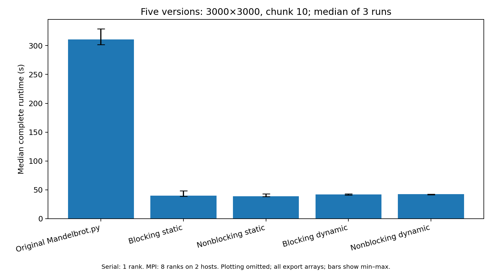

[PDF](Week05/results/verification_job_29710858/figures/benchmark_overview.pdf)
<!-- five-versions:end -->

## Overlaid comparison plots

These three plots show the **revised implementations from heavy-data job 29706381**
on common axes. Color, line style and markers identify the four implementations:
blue solid circles = blocking static; orange dashed squares = nonblocking static;
green dash-dot triangles = blocking dynamic; purple dotted diamonds = nonblocking dynamic.
Points are medians of three repetitions; error bars show the observed min–max.
The original four-panel figures remain in stage 4.

### Physical nodes

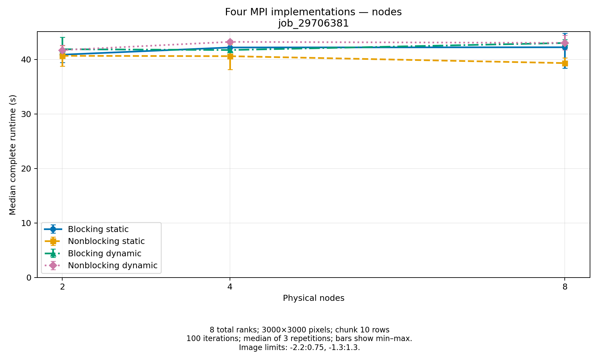

[Download PDF](Week05/results/job_29706381/figures/overlaid/nodes.pdf)

### Chunk size

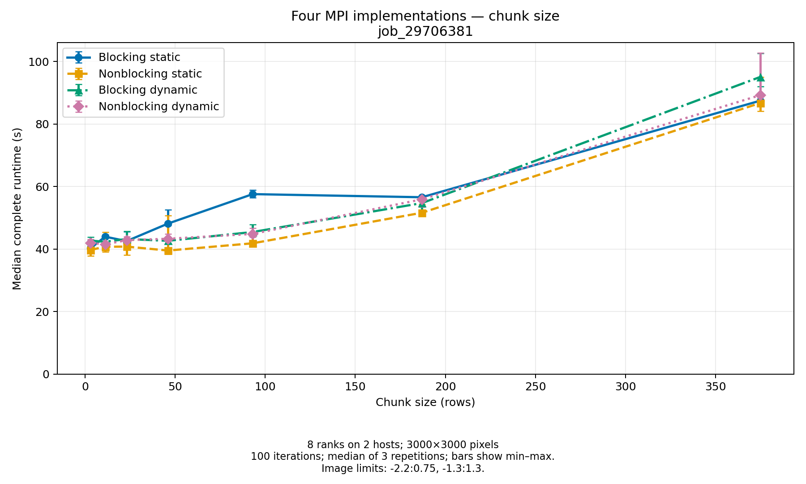

[Download PDF](Week05/results/job_29706381/figures/overlaid/chunk_size.pdf)

### Image area

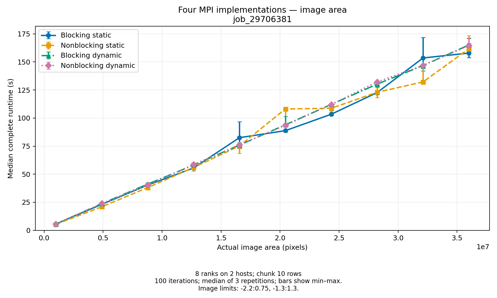

[Download PDF](Week05/results/job_29706381/figures/overlaid/image_area.pdf)

## Experiment history and all retained plots

Each stage has its own data, configuration and exact source snapshots. Expand the
older stages to view their plots. All retained runtime plots have PNG and PDF links;
original exports without error bars are included in a separate archive below.

| Stage | Job | What changed | Recorded result |
|---|---|---|---|
| 1. Initial suite | 29611697 | 1000×1000 node/chunk tests; area up to 2000×2000 | 240 measurements; about 34 min |
| 2. First heavier suite | 29618553 | 3000×3000 node/chunk tests; area up to 6000×6000 | 240 measurements; about 8 h 42 min |
| 3. Diagnostic follow-up | 29702836 | Original/interleaved versions, chunks 8–12, one/two hosts, per-rank timing | 175 measurements; about 2 h 52 min |
| 4. Student's revised blocking-static code | 29706381 | Same full heavier grid, receiving after each round, exact preflight checks | 240 measurements; about 4 h 32 min |
| 5. Extended correctness and serial baseline | 29710858 | All heavier image/chunk combinations; matched five-version benchmark | See the live overview above |

### 1. Initial suite — establish a baseline

**October 6, 2026; job 29611697.** Eight total ranks; three repetitions. Node/chunk
tests use **1000×1000**; image sides range from **100 to 2000**. CPU: Xeon E5-2660 v3;
NumPy 2.3.1, mpi4py 4.0.3, Open MPI 5.0.8.

Small images can make process startup and imports a substantial fraction of total
runtime. That motivated heavier tests. It did not establish that the four designs
were equivalent at larger sizes. Chunk 1 and chunk 3 in this initial suite took
about **5.77 and 5.82 seconds** for blocking static: there was no sharp jump between them.

[Measurements](Week05/results/job_29611697/measurements.csv) ·
[Metadata/configuration](Week05/results/job_29611697/metadata.json) ·
[Measured source](Week05/results/job_29611697/sources/)

<details>
<summary>View all three initial-suite plots</summary>


[Nodes PDF](Week05/results/job_29611697/figures/nodes.pdf)


[Chunk-size PDF](Week05/results/job_29611697/figures/chunk_size.pdf)


[Image-area PDF](Week05/results/job_29611697/figures/image_area.pdf)

</details>

### 2. First heavier suite — expose the waiting problem

**October 7, 2026; job 29618553.** Eight ranks; three repetitions. Node/chunk tests
use **3000×3000**, area up to **6000×6000**. CPU: Xeon E5-2660 v3; Open MPI 5.0.10,
mpi4py 4.1.1 and NumPy 2.4.1.

The original blocking-static code computed all of rank zero's chunks before
receiving, then collected every chunk from one worker before moving to the next.
At 6000×6000 it took **1052.08 s**, while the other implementations took **147–153 s**.
The chunk plot's first two tested sizes are **3 and 11**, not 1 and 3. Blocking static
jumped from **70.26 s** at chunk 3 to **265.84 s** at chunk 11, then fell to **80.79 s**
at chunk 375. Larger chunks can stop workers inside Send before their next computation;
at chunk 375 each static rank has only one chunk, so no subsequent chunk is held up.

These plots now include observed **min–max error bars**. They are not confidence
intervals. [Written analysis](Week05/RESULTS_ANALYSIS.md) ·
[Measurements](Week05/results/job_29618553/measurements.csv) ·
[Metadata](Week05/results/job_29618553/metadata.json) ·
[Measured source](Week05/results/job_29618553/sources/)

### Original blocking-static heavy-data results for discussion

These plots isolate **the old blocking-static implementation from job 29618553**,
before receiving was moved into the computation loop. They retain the original
measurements and show three-repetition medians with min–max bars.
The chunk-size peak and steep area growth are evidence for the waiting problem
discussed above and in stage 3. The first chunk size is **3 rows**, not 1.

Use the matched stage-3 diagnostic to assess the code change: this old job used
Xeon E5-2660 v3, while the revised full suite used E5-2650 v4. Their timing
difference includes both code and execution-environment differences.

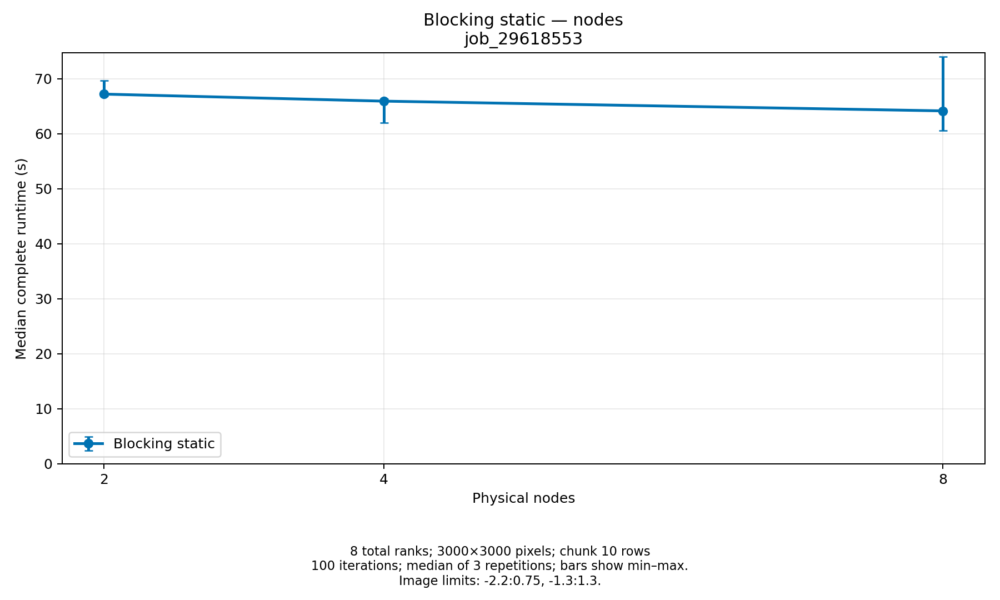

[Physical nodes PDF](Week05/results/job_29618553/figures/static_blocking/nodes.pdf)

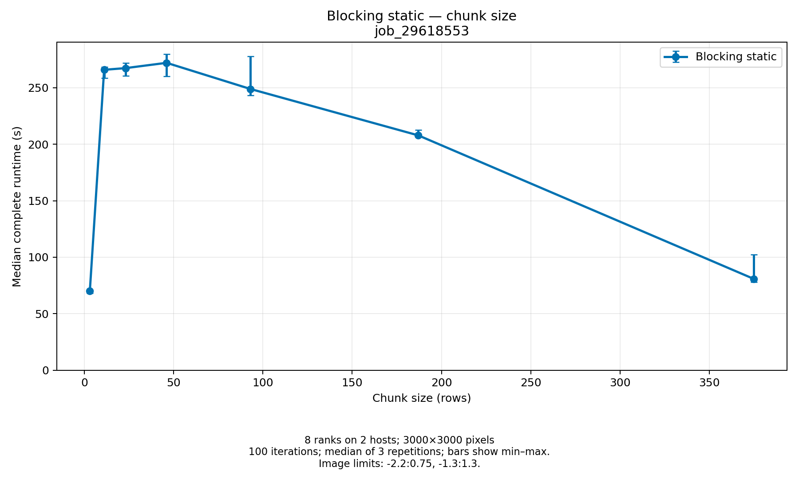

[Chunk size PDF](Week05/results/job_29618553/figures/static_blocking/chunk_size.pdf)

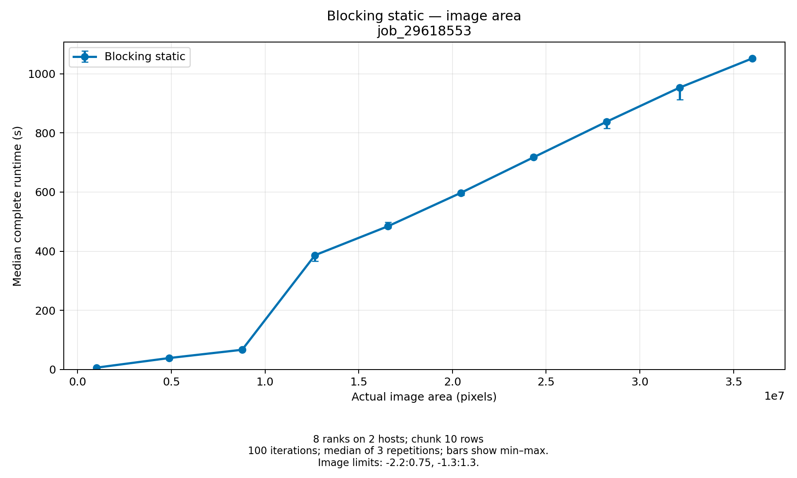

[Image area PDF](Week05/results/job_29618553/figures/static_blocking/image_area.pdf)

<details>
<summary>View the heavier-suite plots with repetition ranges</summary>


[Nodes PDF](Week05/results/job_29618553/figures/nodes.pdf)


[Chunk-size PDF](Week05/results/job_29618553/figures/chunk_size.pdf)


[Image-area PDF](Week05/results/job_29618553/figures/image_area.pdf)

</details>

<details>
<summary>View the original exports from this same run, before error bars were added</summary>

These are earlier presentations of the **same measurements**, not additional experiments.

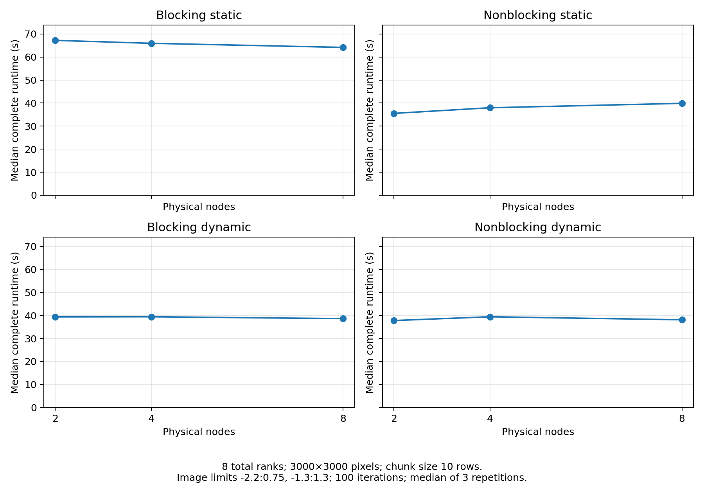

[Nodes PDF](Week05/results/job_29618553/figures/original_without_ranges/nodes.pdf)

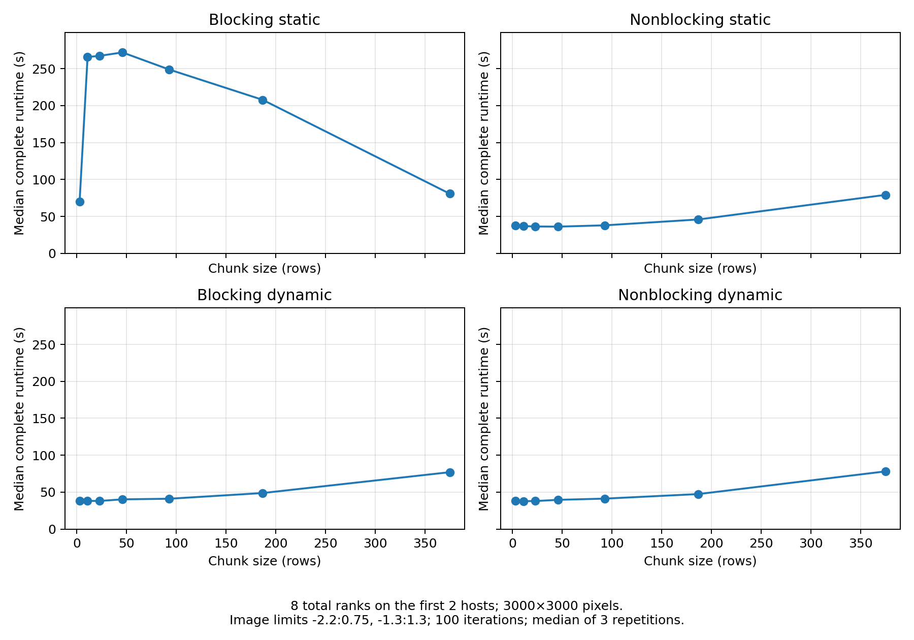

[Chunk-size PDF](Week05/results/job_29618553/figures/original_without_ranges/chunk_size.pdf)

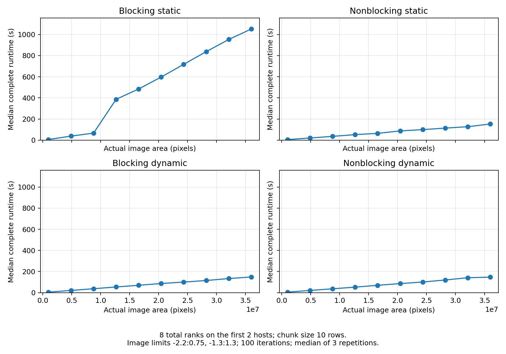

[Image-area PDF](Week05/results/job_29618553/figures/original_without_ranges/image_area.pdf)

</details>

### 3. Diagnostic follow-up — test the explanation

**October 12, 2026.** The follow-up kept **3000×3000**, tested chunks **8–12**, and
compared **one versus two hosts at eight ranks**. It also timed computation and
Send/Recv calls for the original and interleaved blocking-static versions.

The controlled comparison was much clearer than comparing separate jobs: at
chunk 11, the original median was **246.60 s** and the interleaved median **35.48 s**.
The median of each run's maximum worker Send duration fell from **215.20 to 4.48 s**.
Both versions used blocking communication on the same allocation. This supports
the receive-order explanation; it does not identify a precise MPI buffering threshold.
One/two-host medians were close at fixed rank count. Adding hosts did not add ranks.

<details>
<summary>View the threshold, one/two-host and per-rank timing plots</summary>

<!-- followup:start -->
#### Diagnostic plots

Job **29702836**: **175 successful measurements**, five repetitions; 3000×3000 pixels, eight ranks; chunks 8–12 and one versus two hosts.

[Results and interpretation](Week05/results/followup_job_29702836/SUMMARY.md). CPU: Intel(R) Xeon(R) Gold 6226R CPU @ 2.90GHz.


[PDF](Week05/results/followup_job_29702836/figures/threshold.pdf)


[PDF](Week05/results/followup_job_29702836/figures/one_vs_two.pdf)


[PDF](Week05/results/followup_job_29702836/figures/rank_timings.pdf)
<!-- followup:end -->

</details>

### 4. Student's revised code — rerun the entire heavier grid

**October 13, 2026; job 29706381.** The student moved rank zero's receiving into
the chunk loop, collecting round `j` before computing round `j+1`. The full heavier
suite was rerun: **240 successful measurements** and **12 exact image checks**.
CPU: Xeon E5-2650 v4; the software versions match stage 2.

At **6000×6000**, the new medians are:

| Blocking static | Nonblocking static | Blocking dynamic | Nonblocking dynamic |
|---:|---:|---:|---:|
| 157.88 s | 161.77 s | 165.10 s | 164.49 s |

Blocking static now sits close to the other three implementations. The complete
suite finished in about **4 h 32 min**, compared with **8 h 42 min** in stage 2.
The CPU model and shared-host conditions also changed, so that cross-job difference
cannot be attributed entirely to code. Stage 3 supplies the matched comparison.

[Measurements](Week05/results/job_29706381/measurements.csv) ·
[Measured source](Week05/results/job_29706381/sources/) ·
[Correctness evidence](Week05/results/job_29706381/metadata.json)

<!-- latest-benchmark:start -->
#### Full-grid plots

Job **29706381**: 240 successful measurements, three repetitions per configuration, on the same allocated hosts. CPU: Intel(R) Xeon(R) CPU E5-2650 v4 @ 2.20GHz.

Node and chunk tests: 3000×3000 pixels. [Saved results](Week05/results/job_29706381/metadata.json) include configuration, timings, source snapshots, placement checks and logs.

##### Nodes

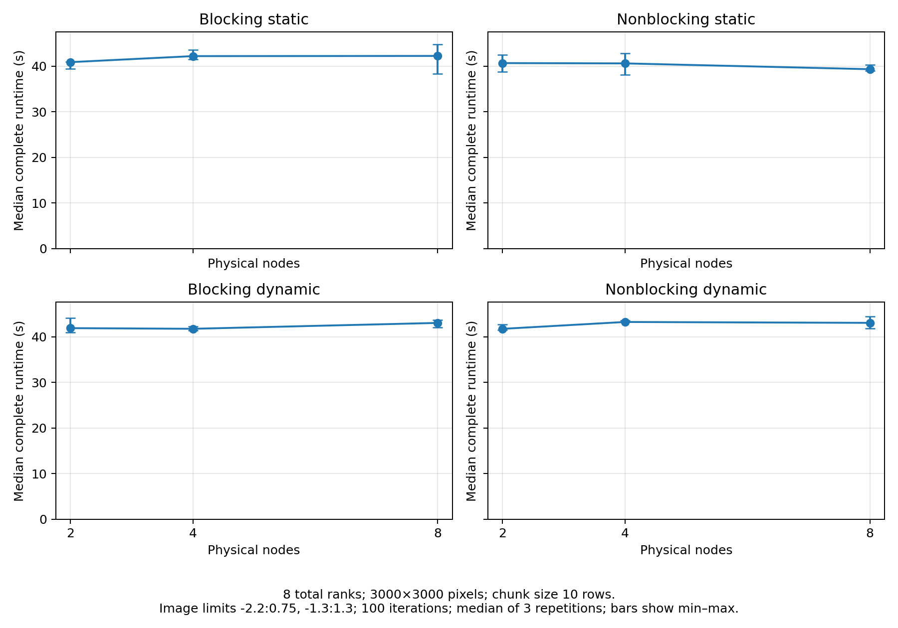

[Download PDF](Week05/results/job_29706381/figures/nodes.pdf)

##### Chunk Size

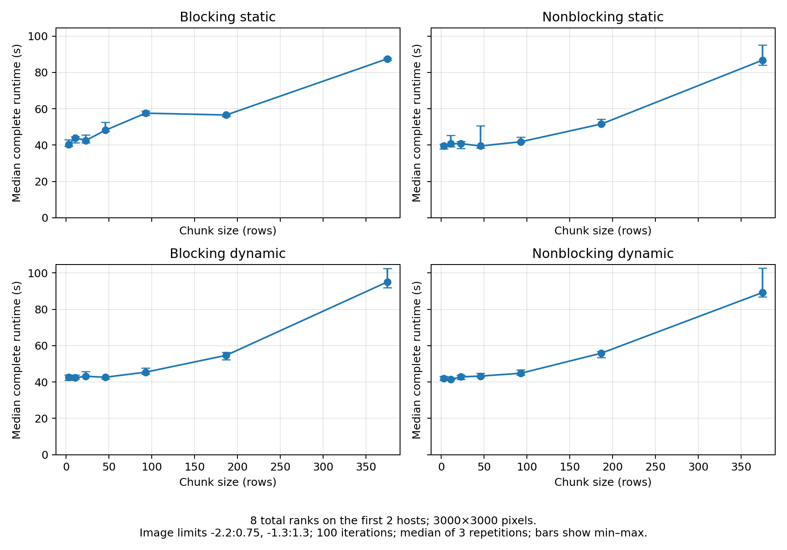

[Download PDF](Week05/results/job_29706381/figures/chunk_size.pdf)

##### Image Area

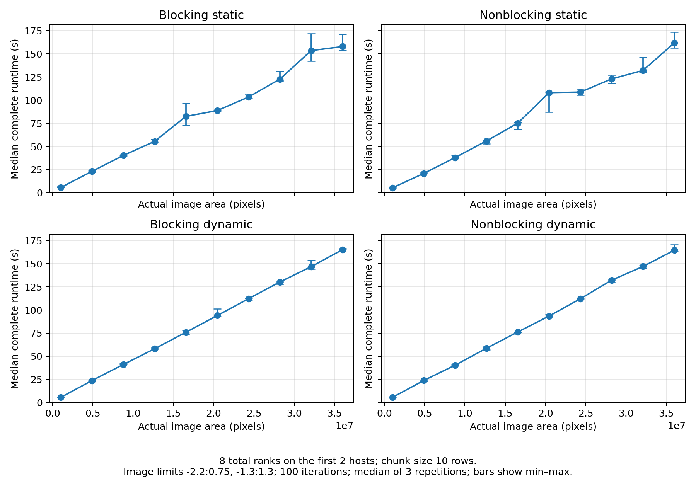

[Download PDF](Week05/results/job_29706381/figures/image_area.pdf)
<!-- latest-benchmark:end -->

### 5. Full-image correctness and a matched serial baseline

The serial reference is needed for two separate questions: **are the pixels right?**
and **how much faster is parallel computation?** The current extension checks all
18 heavier image/chunk combinations with four implementations, then runs three
matched benchmark repetitions of the serial reference plus the four MPI versions.

Every final image and row chunk must match the original reference through
`np.array_equal`; shape and dtype must also match. Array comparisons and compression
are excluded from timing. The serial benchmark omits its plotting-only section to
match the MPI calculation workflow; its original numerical statements are unchanged.
The final table and evidence appear in the overview at the top after completion.

## Code development and mistakes

### The receive-order change

The original structure delayed communication until after rank zero's work:

```python
for chunk in chunks:
    # Compute this chunk; workers send their result.
    ...

if rank == 0:
    # Only now receive all chunks, worker by worker.
    ...
```

The student's revised structure receives regularly:

```python
for j, k in enumerate(chunks):
    buf = compute_chunk(...)
    if rank == 0:
        image[start:stop] = buf
        for r in range(1, nranks):
            if j < len(all_chunks[r]):
                rows = all_chunks[r][j]
                comm.Recv(image[rows[0]:rows[-1] + 1], source=r, tag=r)
    else:
        comm.Send(buf, dest=0, tag=rank)
```

The assignment remains static and cyclic, and communication remains blocking.
The check for `j < len(all_chunks[r])` handles ranks with fewer chunks. Rank zero
owns at least as many cyclic chunks as the other ranks, so its loop covers all
receive rounds. It can still wait for a slow worker in a round; that is a performance
trade-off. The old receive order was a performance weakness, not proof of wrong pixels.

### What went wrong, what changed, and what we learned

| Observation or mistake | Correction | Lesson for the report |
|---|---|---|
| Small images gave limited separation between several designs. | Increase node/chunk images to 3000×3000 and area maximum to 6000×6000. | Startup costs can hide computation/communication differences. |
| Rank zero computed all its work before receiving, then received worker by worker. | Receive results after each cyclic round; investigate Send/Recv time. | Communication order can remove parallel progress even with correct work assignment. |
| We discussed plotted point positions as though they were chunk values. | Read the saved grid: the heavy plot starts at 3 and 11 rows. | Always distinguish point index, axis value and experiment configuration. |
| We expected the smallest chunk to be slow solely because it sends more messages. | Consider computation per row, fine load balancing and receive ordering together. | More messages does not automatically mean a longer complete runtime. |
| A requested point replacement was first run on the small dataset; later scope was misunderstood. | Cancel/revert the retest changes and preserve the original datasets; the student then requested the full heavier rerun. | Agree the exact dataset and grid before submission. Changing one point to a different implementation cannot establish a comparable new curve. |
| Open MPI 5.0.8 crashed during eight-host startup in failed jobs 29612971/29617652. | Upgrade to Open MPI 5.0.10 / PRRTE 3.0.13, use consistent modules and stress-test starts. | A launcher failure is distinct from a numerical algorithm failure. Failed/incomplete runs cannot become completed median results. |
| The first automatic publisher failed because an inner `shlex` import changed Python name scope. | Correct the import and test the complete clone/commit/push path against a local Git remote. | A dry run alone does not validate the actual publication path. |
| Successful process exits did not establish numerical correctness for every tested image. | Add exact serial-reference comparisons; extend them across the heavier image/chunk combinations. | Runtime and correctness require separate evidence. |
| The first follow-on job lost `PARENT_RESULTS_DIR` in the batch environment and stopped before checking images. | Resolve the saved parent directory locally by default, add a regression check, and restart as 29710858. | Test batch defaults without assuming exported variables survive submission. |

The discarded point-replacement charts remain removed as requested. They are
recorded here as a scope/provenance lesson; their results are not inserted into
any retained comparison. The failed launch jobs remain separate from completed data.

Nonblocking static also retains send buffers until `Waitall` completes. An `Isend`
call alone does not make it safe to overwrite its buffer. In the dynamic version,
immediately waiting on many requests limits overlap, which helps explain why
blocking and nonblocking dynamic timings are often similar.

## Reading the figures correctly

- Node tests keep **eight total ranks**: spreading them over more hosts tests
  placement, not scaling with additional processors.
- Dynamic runs use **seven computing workers and one manager**; static runs use
  all eight ranks for computation.
- A 375-row chunk in a 3000-row image creates only **eight chunks**, limiting
  opportunities to balance unequal row costs.
- Error bars show observed **min–max**, not confidence intervals. A slightly lower
  median is not proof of a statistically significant winner.
- Compare algorithms within a matched allocation first. Cross-job comparisons
  can also reflect CPU model, software, shared-host load and source changes.
- Plot image area using the **actual rounded dimensions**, not the target area.

## Running and reproducing the project

```sh
git clone https://github.com/mathiaskrois/02616_LargeScaleModeling.git
cd 02616_LargeScaleModeling/Week05
python3 run_experiments.py --dry-run
export EXPERIMENT_WORK_DIR="$PWD"
bsub < experiments_job.sh
```

The full heavier grid uses eight ranks, default limits `-2.2:0.75` / `-1.3:1.3`
and 100 iterations, with three shuffled repetition rounds (seed 261605):

| Sweep | Values | Fixed settings |
|---|---|---|
| Physical hosts | 2, 4, 8 | 3000×3000; chunk 10 |
| Chunk rows | 3, 11, 23, 46, 93, 187, 375 | 3000×3000; first two hosts |
| Image side | 1000, 2211, 2963, 3559, 4069, 4522, 4933, 5312, 5667, 6000 | First two hosts; chunk 10 |

Submit only the batch entry point; its commands run sequentially in one allocation,
without nested jobs. It reserves 32 slots, four on each of eight hosts, for up to
12 hours. The queue and probes enforce a common CPU model. Core binding and MPI
versions are checked before timing. NumPy/mpi4py/Matplotlib modules are loaded
consistently, with OMP/OpenBLAS threads set to one and a noninteractive plot backend.

```sh
bjobs JOBID
python3 plot_experiments.py results/job_JOBID
python3 publish_results.py results/job_JOBID
```

The runner records every measured attempt and keeps logs, pilots, configuration,
versions, CPU/host placement and source hashes. Analysis rejects failed, duplicate
or incomplete groups. Publication verifies completed outputs, uses an isolated
checkout and never force-pushes. GitHub credentials remain signed in and excluded
from Git. A completed numerical suite can still have a separate publication error;
inspect the batch log and retry the publisher without rerunning the calculations.

| Version | Current source |
|---|---|
| Serial reference | [Mandelbrot.py](Week05/Mandelbrot.py) |
| Blocking static | [Mandelbrot_blocking_static.py](Week05/Mandelbrot_blocking_static.py) |
| Nonblocking static | [Mandelbrot_nonblocking_static.py](Week05/Mandelbrot_nonblocking_static.py) |
| Blocking dynamic | [Mandelbrot_blocking_dynamic.py](Week05/Mandelbrot_blocking_dynamic.py) |
| Nonblocking dynamic | [Mandelbrot_nonblocking_dynamic.py](Week05/Mandelbrot_nonblocking_dynamic.py) |

For historical comparisons use each job's **source snapshots**, not today's files.
The initial suite's images and chunk grid differ from the heavier suite. The
assignment's one-node comparison is supplied by the diagnostic follow-up, not
by the original 2/4/8-host node grid.

[Assignment](Week05/Project.tex) · [Experiment design](Week05/EXPERIMENTS.md) ·
[Heavy-suite analysis](Week05/RESULTS_ANALYSIS.md) · [Diagnostic design](Week05/FOLLOWUP.md) ·
[Correctness/overview method](Week05/CORRECTNESS_AND_BENCHMARK.md)

## Serial reference illustration

This is the Mandelbrot illustration supplied with the course project, not a runtime benchmark.

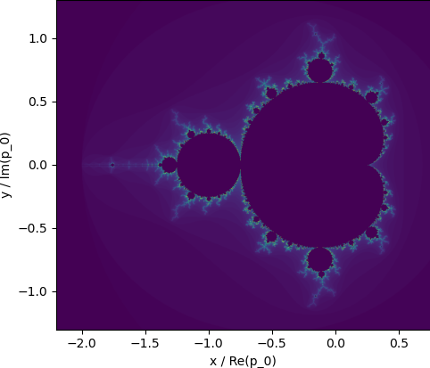

## Working as a group and source credit

Use a branch for each change and open a pull request. Keep each completed run in
its own results directory; do not rewrite raw measurements when the code changes.
Top-level scheduler logs, caches and virtual environments are ignored; archived
run logs, figures and source snapshots are intentionally tracked.

The reference, assignment and course framing originate from the
[02616 student repository](https://gitlab.gbar.dtu.dk/dcc-teaching/02616/02616-student).
The MPI programs and experiment tooling are the group's project work.
`Week05/vendor/six.py` retains its original license header.

To reproduce the additional discussion/comparison figures from saved measurements:

```sh
python Week05/plot_comparisons.py Week05/results/job_29706381
python Week05/plot_comparisons.py Week05/results/job_29618553 --implementation static_blocking
```
