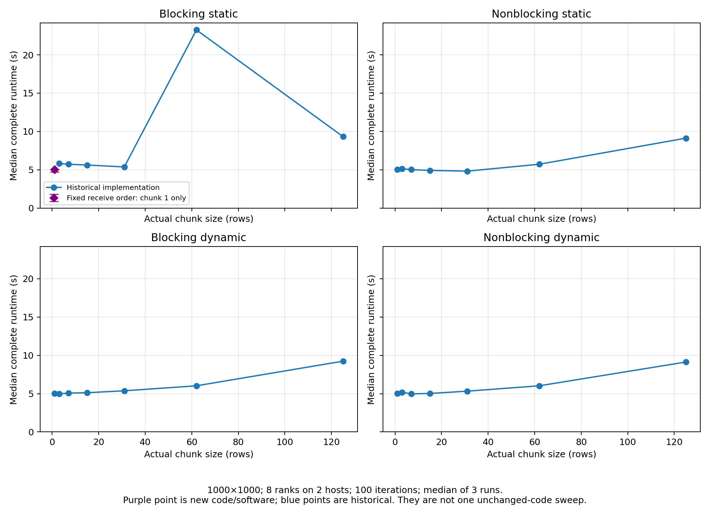

# Chunk-size-1 retest

Job **29705865**: three successful runs of the fixed blocking-static implementation.

- Image: 1000×1000; eight ranks on two hosts; chunk 1; default limits; 100 iterations.
- Original chunk-1 median: **5.775 s**.
- Updated chunk-1 median: **5.023 s**, observed range 4.723–5.023 s.
- CPU: Intel(R) Xeon(R) CPU E5-2660 v3 @ 2.60GHz.
- Exact full-image equality with the serial reference passed before timing.

The receive order now interleaves computation and receiving after each cyclic round.
The original source is retained as Mandelbrot_blocking_static_legacy.py and in historical snapshots.

`updated_initial/measurements.csv` substitutes only the three blocking-static chunk-1 rows in a copy of the 240-row original dataset. The other 237 rows are unchanged except for explicit provenance and log-path references. Original raw files and plots are preserved.

The purple replacement point is intentionally not connected to the historical blocking-static line: the algorithms differ. The software stack also changed from Open MPI 5.0.8 / NumPy 2.3.1 to Open MPI 5.0.10 / NumPy 2.4.1. Therefore the difference cannot be attributed solely to the code change. The old chunk-1 result was not a failed measurement.

No other chunk sizes were rerun. The remaining shape belongs to the historical implementation; replacing one point does not establish a complete curve for the fixed implementation.

[PDF](figures/chunk_size.pdf)
