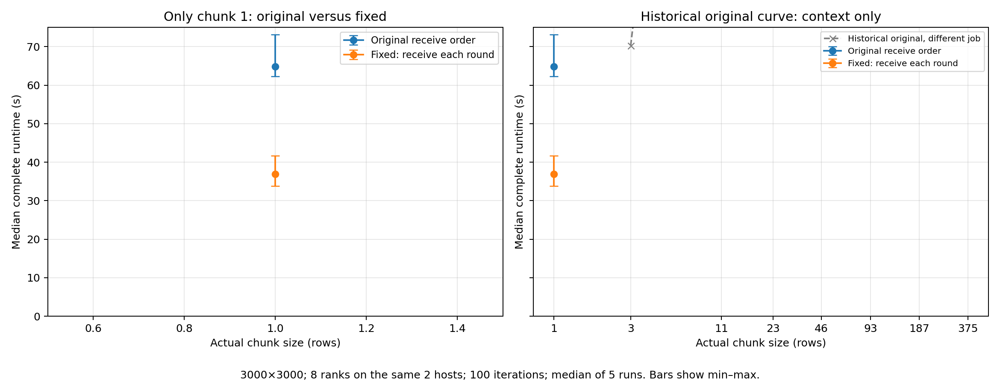

# Heavier chunk-size comparison

## Observation: I expected chunk size 1 to be slow

This expectation is reasonable: chunk 1 creates 3000 chunks and many Send/Recv calls. However, each row has 3000 pixels of computation, and fine partitioning distributes unequal row costs. Whether message overhead dominates must be measured.

Only the two chunk-1 points are new measurements, taken in one allocation and software environment. The dashed gray curve supplies unchanged historical original-version context; it is not part of this retest. No other chunk sizes were rerun.

## Measurements

| Chunk rows | Original median s | Original min–max s | Fixed median s | Fixed min–max s | Original / fixed |
|---:|---:|---|---:|---|---:|
| 1 | 64.870 | 62.288–73.114 | 36.871 | 33.826–41.630 | 1.76× |

## Does chunk 1 behave as expected?

- **Original receive order:** chunk 1 takes **64.870 s**.
- **Fixed receive order:** chunk 1 takes **36.871 s**.

This retest compares receive order only at chunk 1. It cannot establish the fastest chunk for the corrected implementation or whether chunk 1 is slower than its other chunks. The historical curve is context only. Consult the min–max ranges when comparing the two versions.

## What changed in the implementation?

The original version finishes rank zero’s own computation before receiving every result from worker one, then worker two, and so on. Workers can wait in Send while they still have computation left.
The fixed version retains cyclic static row assignment, identical arithmetic and blocking Send/Recv, but receives each round before starting the next. Both calculate the correct pixels; this addresses avoidable waiting, not a special arithmetic bug at chunk 1.
At intermediate message sizes the original can lose parallelism when sends wait for receives. At chunk 375 each static rank has only one chunk, so a delayed send cannot hold up subsequent computation. Very coarse chunks can still suffer unequal row costs in either version.
The earlier profiled diagnostic follow-up supports the receive-order explanation. This new comparison times uninstrumented versions; it does not measure the exact MPI buffering threshold.

## Method and limits

Ten complete MPI launch-to-exit runtimes, five repetitions per version, only chunk 1; 3000×3000, default limits, 100 iterations, eight ranks on two allocated hosts with separate physical core bindings. All launches are sequential, randomized within each of five rounds using seed 261613.
Both implementations passed an exact serial-reference check on a rectangular image with partial chunk-1 rounds before timing. The full 3000×3000 timed images are not separately saved and compared.
The same CPU model and software are used for both curves, but hosts are shared with other jobs. Error bars are observed ranges, not confidence intervals. Comparisons against older jobs remain subject to cross-job variation.

[Download PDF](figures/chunk_size_comparison.pdf)
