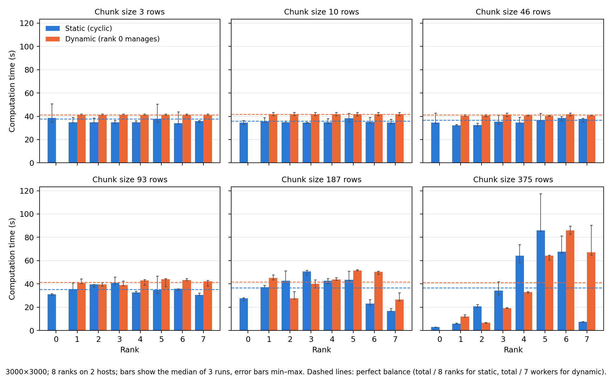
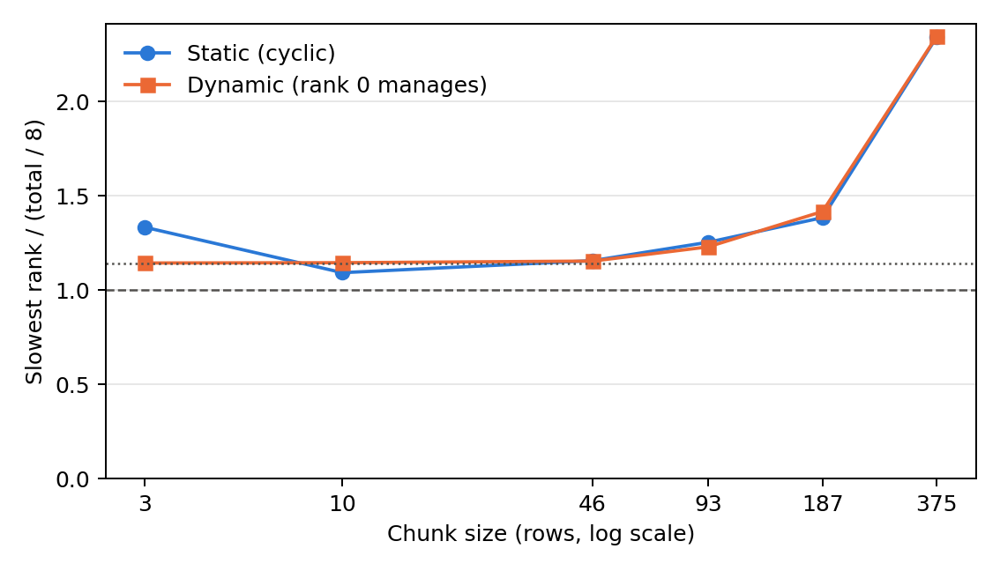

# Load-imbalance measurements

36 successful runs; 3000×3000; 8 ranks on 2 hosts; median of 3 repetitions. Computation time excludes MPI calls.

## Imbalance per chunk size

| Implementation | Chunk rows | Runtime (s) | Max/mean over computing ranks | Slowest / (total/8) |
|---|---:|---:|---:|---:|
| Static (cyclic) | 3 | 51.60 | 1.333 | 1.333 |
| Static (cyclic) | 10 | 41.08 | 1.092 | 1.092 |
| Static (cyclic) | 46 | 49.74 | 1.156 | 1.156 |
| Static (cyclic) | 93 | 54.78 | 1.253 | 1.253 |
| Static (cyclic) | 187 | 52.27 | 1.384 | 1.384 |
| Static (cyclic) | 375 | 86.84 | 2.341 | 2.341 |
| Dynamic (rank 0 manages) | 3 | 42.14 | 1.000 | 1.143 |
| Dynamic (rank 0 manages) | 10 | 42.75 | 1.002 | 1.145 |
| Dynamic (rank 0 manages) | 46 | 42.80 | 1.009 | 1.154 |
| Dynamic (rank 0 manages) | 93 | 45.64 | 1.075 | 1.229 |
| Dynamic (rank 0 manages) | 187 | 52.65 | 1.239 | 1.416 |
| Dynamic (rank 0 manages) | 375 | 86.92 | 2.052 | 2.345 |

## Median computation time per rank (s)

| Implementation | Chunk rows | Rank 0 | Rank 1 | Rank 2 | Rank 3 | Rank 4 | Rank 5 | Rank 6 | Rank 7 |
|---|---:|---:|---:|---:|---:|---:|---:|---:|---:|
| Static (cyclic) | 3 | 38.6 | 34.9 | 34.8 | 35.0 | 34.7 | 37.7 | 34.1 | 35.9 |
| Static (cyclic) | 10 | 34.6 | 35.7 | 34.7 | 34.7 | 34.7 | 38.3 | 35.0 | 34.5 |
| Static (cyclic) | 46 | 34.6 | 32.3 | 32.4 | 35.3 | 34.6 | 36.6 | 38.5 | 37.8 |
| Static (cyclic) | 93 | 31.2 | 35.5 | 39.5 | 40.8 | 32.6 | 34.8 | 35.7 | 30.6 |
| Static (cyclic) | 187 | 27.7 | 37.3 | 42.6 | 50.5 | 42.8 | 43.6 | 23.0 | 16.8 |
| Static (cyclic) | 375 | 3.0 | 6.0 | 20.8 | 34.3 | 64.2 | 85.9 | 67.7 | 7.5 |
| Dynamic (rank 0 manages) | 3 | 0.0 | 41.1 | 41.1 | 41.1 | 41.1 | 41.1 | 41.1 | 41.1 |
| Dynamic (rank 0 manages) | 10 | 0.0 | 41.7 | 41.7 | 41.7 | 41.7 | 41.8 | 41.7 | 41.8 |
| Dynamic (rank 0 manages) | 46 | 0.0 | 40.3 | 40.7 | 41.6 | 40.7 | 40.3 | 41.7 | 40.7 |
| Dynamic (rank 0 manages) | 93 | 0.0 | 40.8 | 39.5 | 38.9 | 43.0 | 43.9 | 43.3 | 42.1 |
| Dynamic (rank 0 manages) | 187 | 0.0 | 45.2 | 27.6 | 40.2 | 43.7 | 51.6 | 50.5 | 26.6 |
| Dynamic (rank 0 manages) | 375 | 0.0 | 12.0 | 6.6 | 19.2 | 32.9 | 64.2 | 86.0 | 67.2 |

## Dynamic scheduler: median chunks computed per worker

| Chunk rows | Rank 1 | Rank 2 | Rank 3 | Rank 4 | Rank 5 | Rank 6 | Rank 7 |
|---:|---:|---:|---:|---:|---:|---:|---:|
| 3 | 142 | 144 | 140 | 141 | 143 | 145 | 149 |
| 10 | 44 | 44 | 40 | 42 | 41 | 44 | 45 |
| 46 | 10 | 9 | 10 | 9 | 9 | 8 | 10 |
| 93 | 5 | 6 | 5 | 4 | 4 | 4 | 4 |
| 187 | 3 | 2 | 2 | 2 | 2 | 2 | 4 |
| 375 | 2 | 1 | 1 | 1 | 1 | 1 | 1 |

## Notes

Static uses Mandelbrot_blocking_static_interleaved.py (same algorithm as Mandelbrot_blocking_static.py, with timers). Dynamic uses Mandelbrot_dynamic_profiled.py (same algorithm as Mandelbrot_blocking_dynamic.py, with timers). Both reproduced the serial reference exactly before measurement.
Computation time per rank does not depend on blocking versus nonblocking communication for static scheduling, since the row assignment is identical.

## Figures

[PDF](figures/rank_compute.pdf)

[PDF](figures/imbalance_ratio.pdf)

