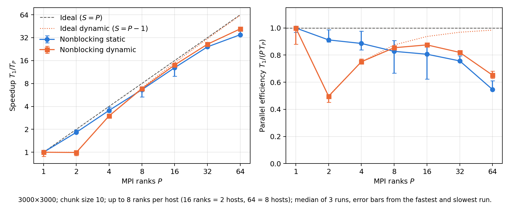
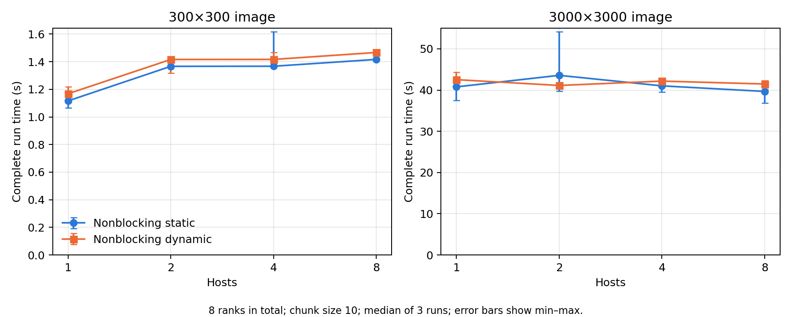

# Scaling and node-placement measurements

90 successful runs; chunk size 10; median of 3 repetitions; complete launch-to-exit run times.

## Strong scaling (3000×3000)

| Implementation | Ranks | Hosts | Median (s) | Min–max (s) | Speedup | Efficiency |
|---|---:|---:|---:|---|---:|---:|
| Nonblocking static | 1 | 1 | 280.55 | 278.89–289.97 | 1.00 | 1.000 |
| Nonblocking static | 2 | 1 | 153.80 | 142.24–156.20 | 1.82 | 0.912 |
| Nonblocking static | 4 | 1 | 79.16 | 71.80–83.62 | 3.54 | 0.886 |
| Nonblocking static | 8 | 1 | 42.37 | 38.62–52.58 | 6.62 | 0.828 |
| Nonblocking static | 16 | 2 | 21.74 | 20.09–28.15 | 12.90 | 0.807 |
| Nonblocking static | 32 | 4 | 11.58 | 11.03–11.68 | 24.23 | 0.757 |
| Nonblocking static | 64 | 8 | 8.02 | 7.18–8.03 | 34.96 | 0.546 |
| Nonblocking dynamic | 1 | 1 | 282.75 | 279.65–321.50 | 1.00 | 1.000 |
| Nonblocking dynamic | 2 | 1 | 284.75 | 282.85–312.84 | 0.99 | 0.496 |
| Nonblocking dynamic | 4 | 1 | 94.13 | 91.62–95.63 | 3.00 | 0.751 |
| Nonblocking dynamic | 8 | 1 | 41.37 | 40.81–41.62 | 6.84 | 0.854 |
| Nonblocking dynamic | 16 | 2 | 20.19 | 20.04–20.39 | 14.00 | 0.875 |
| Nonblocking dynamic | 32 | 4 | 10.78 | 10.58–10.98 | 26.23 | 0.820 |
| Nonblocking dynamic | 64 | 8 | 6.78 | 6.47–7.02 | 41.73 | 0.652 |

## 8 ranks on different numbers of hosts

| Image | Implementation | Hosts | Median (s) | Min–max (s) | Relative to 1 host |
|---|---|---:|---:|---|---:|
| 300×300 | Nonblocking static | 1 | 1.12 | 1.07–1.12 | 1.000 |
| 300×300 | Nonblocking static | 2 | 1.37 | 1.37–1.37 | 1.224 |
| 300×300 | Nonblocking static | 4 | 1.37 | 1.37–1.62 | 1.225 |
| 300×300 | Nonblocking static | 8 | 1.42 | 1.42–1.42 | 1.269 |
| 300×300 | Nonblocking dynamic | 1 | 1.17 | 1.17–1.22 | 1.000 |
| 300×300 | Nonblocking dynamic | 2 | 1.42 | 1.32–1.42 | 1.213 |
| 300×300 | Nonblocking dynamic | 4 | 1.42 | 1.42–1.47 | 1.213 |
| 300×300 | Nonblocking dynamic | 8 | 1.47 | 1.47–1.47 | 1.256 |
| 3000×3000 | Nonblocking static | 1 | 40.77 | 37.46–40.77 | 1.000 |
| 3000×3000 | Nonblocking static | 2 | 43.57 | 39.71–54.18 | 1.069 |
| 3000×3000 | Nonblocking static | 4 | 41.02 | 39.51–42.52 | 1.006 |
| 3000×3000 | Nonblocking static | 8 | 39.66 | 36.86–40.16 | 0.973 |
| 3000×3000 | Nonblocking dynamic | 1 | 42.52 | 41.17–44.37 | 1.000 |
| 3000×3000 | Nonblocking dynamic | 2 | 41.12 | 40.92–41.82 | 0.967 |
| 3000×3000 | Nonblocking dynamic | 4 | 42.17 | 40.81–42.71 | 0.992 |
| 3000×3000 | Nonblocking dynamic | 8 | 41.47 | 41.41–42.27 | 0.975 |

## Notes

Speedup and efficiency use the same implementation on one rank as reference. The dynamic scheduler computes on P−1 workers (rank 0 manages) when P > 1; with one rank, rank 0 computes alone.
Scaling runs fill hosts completely: up to 8 ranks on one host, 16 on two, 32 on four, 64 on eight.
All runs share one allocation; hosts may also run other users' jobs.

## Figures

[PDF](figures/speedup.pdf)

[PDF](figures/nodes.pdf)

